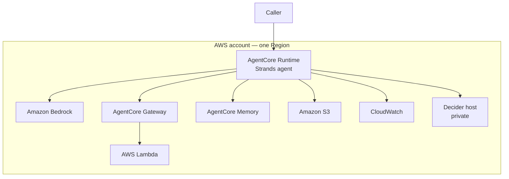

# High Level Architecture Design

**Document ID:** HLAD  
**Version:** 0.1  
**Date:** 2026-10-10  
**Status:** Draft groundwork. No feature is designed here.

The low-level drafts were written first, because there is no feature to hang a full view-set on. This document is the short view over them. Detail lives in the LLADs, not here.

| ID | Document |
|---|---|
| LLAD-ARCH | [Architecture](llad-architecture-v0.1-draft.md) |
| LLAD-DATA | [Data](llad-data-v0.1-draft.md) |
| LLAD-SEC | [Security and IAM](llad-security-iam-v0.1-draft.md) |
| LLAD-DEP | [Deployment](llad-deployment-v0.1-draft.md) |

## 1. Purpose

Provide a single place an agent runs, on AWS, with Amazon Bedrock as the generative model and a typed decision model in front of tool calls.

The feature that agent performs is not chosen in this document.

## 2. Principles

| ID | Principle | Implication |
|---|---|---|
| P1 | AWS is the running environment | AgentCore, Bedrock, Lambda, and the related account services hold the agent. The laptop is not a second environment |
| P2 | Bedrock writes. A decision model classifies | Prose and proposed tool calls come from Bedrock. Typed answers and confidence come from Decider. Code maps those answers to an action |
| P3 | Tools return evidence | The model does not store a fact it did not get from a tool |
| P4 | Identity is not authorization | IAM and JWT say who called. A policy outside the model says which tools exist. Decider says whether this call is fit to run |
| P5 | Low confidence asks a person | The agent does not proceed on a weak answer |
| P6 | Fail closed | If Bedrock or Decider is unavailable, the tool does not run |
| P7 | Local is a last resort | Only Decider may run off the account, and only while its in-account host does not exist. The port is never public |

## 3. Context

| Actor | Relationship |
|---|---|
| Operator | Deploys the stack. Invokes the runtime while no other caller exists |
| AgentCore Runtime | The agent |
| Amazon Bedrock | Generative model |
| Decider host | Typed decisions for the agent |
| Lambda tools | Evidence and side effects, added per feature |

## 4. Software

| Layer | Choice |
|---|---|
| Agent framework | Strands, on AgentCore Runtime |
| Generative model | Amazon Bedrock, model id chosen at deploy |
| Typed decisions | Strands Decider 2B, served in-account |
| Tools | AWS Lambda, via AgentCore Gateway |
| Session | AgentCore Memory. S3 when a feature needs a durable object |
| Identity | IAM for AWS calls. AgentCore Identity when a feature adds a person or an outbound secret |
| Observability | CloudWatch logs and AgentCore traces |

## 5. Views

Each view is a pointer. The LLAD is the design.

| View | Groundwork statement | Detail |
|---|---|---|
| System context | One caller, one agent, Bedrock, tools, a private decision host | [Architecture](llad-architecture-v0.1-draft.md) |
| Actors | Operator only, until a feature names another | [Security and IAM](llad-security-iam-v0.1-draft.md) |
| Interfaces | Runtime invoke, Bedrock, `POST /v1/systemone`, Gateway, Memory, logs | [Architecture](llad-architecture-v0.1-draft.md) |
| Journeys | A turn drafts on Bedrock, is checked, then a tool runs or the agent asks | [Architecture](llad-architecture-v0.1-draft.md) |
| Data | Session and logs in AWS. Models are not the record | [Data](llad-data-v0.1-draft.md) |
| Security | Roles per component. Private path to Decider. Deny by default once tool policy is on | [Security and IAM](llad-security-iam-v0.1-draft.md) |
| Deployment | One account, one Region. Laptop only as a Decider fallback | [Deployment](llad-deployment-v0.1-draft.md) |
| Source and delivery | This repository. No pipeline is defined yet | — |

## 6. Open choices

These are not accepted decisions. They are the next blanks. They do not change P1–P7.

| Blank | Notes |
|---|---|
| Region | One Region, fixed at first deploy |
| Bedrock model id | Allow-listed on the runtime role |
| Decider host size | EC2 or a container that can load the 2B checkpoint. GPU if available, CPU if that is what the account has |
| Decider checkpoint id | Pinned when the host is built. See [decider-2b.md](decider-2b.md) |
| Confidence cutoff | Set from scripted calls, not in this document |
| Whether the runtime container should load Decider itself | Later. Groundwork keeps a separate host |

## 7. Working assumptions

Recorded so implementation does not drift back to a laptop agent.

- The Strands process runs on AgentCore Runtime.
- Bedrock is the only generative API.
- Lambda is how tools run.
- Decider's target host is inside the account.
- The operator laptop deploys and, only if needed, forwards a port. It does not host the agent.
