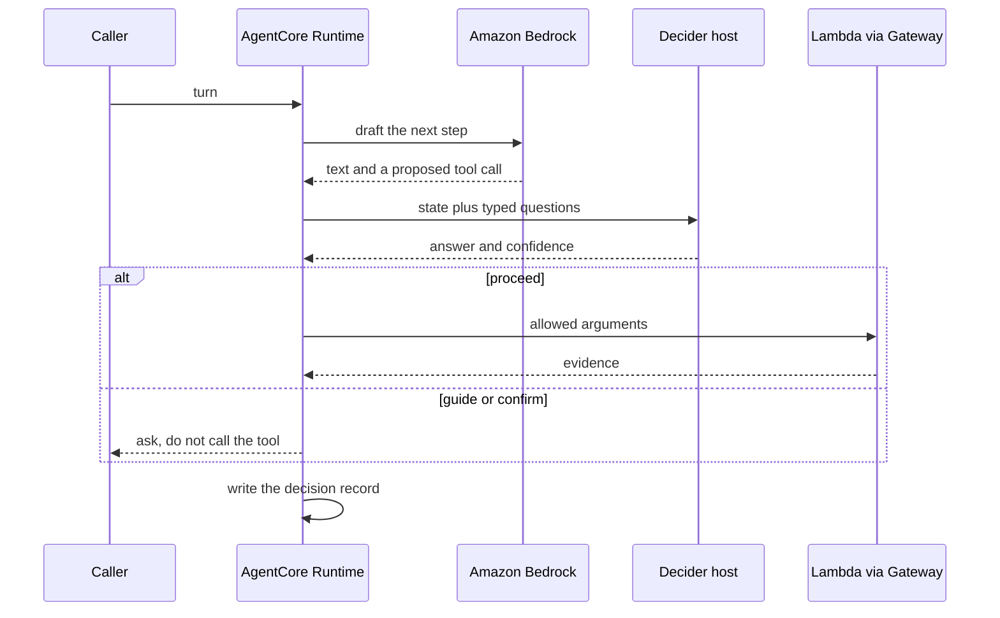

# Architecture — Low Level Architecture Design

**Document ID:** LLAD-ARCH  
**Version:** 0.1  
**Date:** 2026-10-10  
**Status:** Draft groundwork. No feature is designed here.

This is the runtime shape for an agent on AWS. Feature behaviour, tools, and screens are specified later. Placement is fixed in [Deployment](llad-deployment-v0.1-draft.md): the account is the running environment.

## 1. Components

| Component | Responsibility |
|---|---|
| Caller | Sends a turn to the agent. In this groundwork that caller is the operator invoking the runtime |
| AgentCore Runtime | Hosts the Strands agent. Owns the loop: model, tools, interventions |
| Strands agent | Decides which tool to propose. Does not grade its own arguments |
| Amazon Bedrock | Writes the language. Returns text and proposed tool calls |
| Intervention | Runs before a tool executes. Calls Decider. Maps the typed answer to proceed, guide, or confirm |
| Decider host | Answers typed questions about one state. Returns a choice, a yes/no probability, or a score, plus confidence. Does not generate text |
| AgentCore Gateway | Presents Lambda tools to the agent under IAM |
| AWS Lambda | Runs one tool |
| AgentCore Memory | Holds the session |
| Amazon S3 | Holds a durable object when a feature adds one |
| CloudWatch | Holds logs and traces |

## 2. Rules that do not wait for a feature

1. Bedrock proposes. Decider returns a typed answer. Application code chooses the action.
2. A tool runs only after that action is proceed.
3. A tool result is the evidence for the next model turn. The model does not invent a result.
4. Low confidence stops for a person.
5. The Decider call is one request per tool decision, with every question for that decision in the same request.
6. If the Decider host does not answer, the tool does not run. The agent asks the caller to retry. It does not guess the decision.
7. If Bedrock does not answer, the turn fails closed the same way. No local stand-in model.

## 3. Interfaces

| Interface | Contract at this stage |
|---|---|
| Caller → runtime | One turn in, one agent result out. The payload shape is the runtime's invoke API |
| Runtime → Bedrock | Converse or InvokeModel on an allow-listed model in one Region |
| Runtime → Decider | `POST /v1/systemone` on the private host. Body is `state` plus `questions`. See [decider-2b.md](decider-2b.md) |
| Runtime → Gateway → Lambda | Tool name and the arguments the intervention allowed |
| Runtime → Memory | Session id plus the new turn |
| Runtime → CloudWatch | Decision record and tool outcome |

No public HTTP API is defined for a product feature. The runtime's invoke entry is enough until a feature adds a caller.

## 4. Failure

| Failure | Behaviour |
|---|---|
| Bedrock throttle or error | Turn fails. No tool call. Error is logged |
| Decider timeout or connection refused | Tool is not called. Caller is asked to retry |
| Decider confidence under the cutoff | Confirm. A person answers |
| Tool error | The error is evidence returned to the model. The model does not replace it with a guessed success |
| Laptop fallback in use, tunnel down | Treated as Decider unavailable. Same as a timeout |

## 5. Out of scope

Feature tools, feature data, a user interface, multi-agent orchestration, and a second model for evaluation. Orchestration with Step Functions and choreography with EventBridge remain available patterns. This groundwork is one agent.

## 6. References

- [Deployment](llad-deployment-v0.1-draft.md)
- [Data](llad-data-v0.1-draft.md)
- [Security and IAM](llad-security-iam-v0.1-draft.md)
- [HLAD](hlad-v0.1-draft.md)
- [Decider 2B](decider-2b.md)
