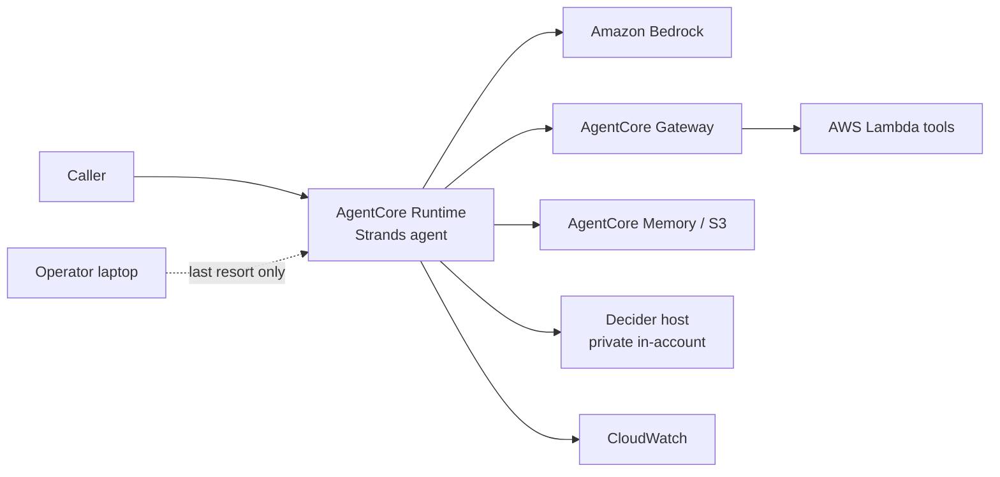

# Deployment — Low Level Architecture Design

**Document ID:** LLAD-DEP  
**Version:** 0.1  
**Date:** 2026-10-10  
**Status:** Draft groundwork. No feature is designed here.

The running environment is **AWS**. Amazon Bedrock AgentCore hosts the Strands agent. Amazon Bedrock generates. AWS Lambda and the related AWS services do the rest of the work. A process on the operator laptop is a last resort, used only for a component that cannot run in that account yet.

## 1. Placement

| Component | Where it runs | Why |
|---|---|---|
| Strands agent | AgentCore Runtime | Managed runtime for the agent loop, tools, and model calls |
| Generative model | Amazon Bedrock, one Region | The only model API this design uses for prose |
| Tools and short functions | AWS Lambda | Called from the agent, through AgentCore Gateway when the tool is an external capability |
| Session and memory | AgentCore Memory, with Amazon S3 where a durable transcript is required | The agent process is not the store |
| Identity | AgentCore Identity, plus IAM roles | Inbound caller and outbound AWS calls |
| Logs and traces | Amazon CloudWatch, including AgentCore trace delivery | Who called, what ran, allow or deny |
| Typed decision model (Decider 2B) | **Target:** a private compute host in the same account and Region (Amazon EC2 or a container on that host). **Last resort:** the operator laptop, and only while that host does not exist | Decider is not a Bedrock model. The published server has no authentication and binds to localhost. It is not a public endpoint. Lambda is a poor host for a 2B-parameter model |

The dotted line is the fallback. The solid path is the design.

## 2. What is in the account

One AWS account. One Region, chosen when the first stack is deployed and then kept. No second Region in this groundwork.

| Service | Role in this groundwork |
|---|---|
| Amazon Bedrock AgentCore Runtime | Runs the Strands agent |
| Amazon Bedrock | Foundation-model API used by that agent |
| AgentCore Gateway | Front door for tools that must not be called with a secret in the agent image |
| AgentCore Identity | Workload identity and outbound credentials |
| AgentCore Memory | Session turns |
| AWS Lambda | Tool handlers and any small function the agent needs |
| Amazon S3 | Durable session or artifact bucket, when Memory is not enough |
| Amazon CloudWatch | Application logs, usage logs, traces |
| AWS IAM | Roles for runtime, functions, and the Decider host |
| Amazon EC2, or a container on EC2 | Private host for `strands-decider serve` |

Related services stay available and unused until a feature needs them: Amazon EventBridge, AWS Step Functions, Amazon Cognito, Amazon Verified Permissions, AWS Secrets Manager. Naming one here does not put it in the first deploy.

## 3. Decider, and why the laptop is not the design

`strands-decider serve` is a local process. The published guidance binds it to `127.0.0.1` with no authentication, and says to use it for local experiments. An AgentCore runtime in AWS cannot call `127.0.0.1` on a laptop.

The in-account host runs the same serve command on a private address the runtime can reach. Security groups allow that path from the runtime only. The host does not have a public listener.

The laptop is allowed only when that host is not up yet, and only through a private forward (SSM port forward or an equivalent tunnel) to the runtime's call. The Decider port is not published on the internet in either case.

Loading the model inside the AgentCore runtime container, next to the agent, is a later option if the runtime's size and startup can carry a 2B model. It is not the groundwork assumption. A separate host keeps agent deploys independent from model loads.

## 4. Environments

| Environment | What it is |
|---|---|
| Account, one Region | The only running environment |
| Laptop | Operator tools, and the Decider fallback while the host is absent |

There is no second cloud and no long-lived local agent. Build and deploy happen from the operator machine. The agent does not stay running there.

## 5. What this draft does not deploy

No infrastructure template is written yet. No model id, instance size, or account id is chosen. Feature tools, tables, and screens are out of scope until a feature spec exists.

## 6. References

- [HLAD](hlad-v0.1-draft.md)
- [Security and IAM](llad-security-iam-v0.1-draft.md)
- [Data](llad-data-v0.1-draft.md)
- [Decider 2B](decider-2b.md) — install, serve, and the localhost limit
